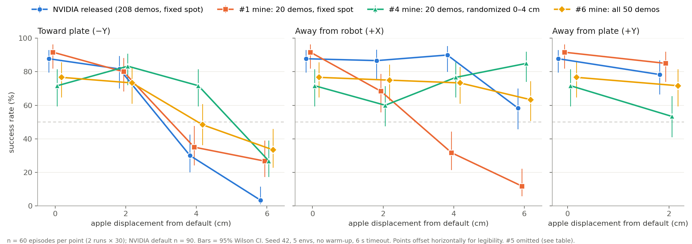
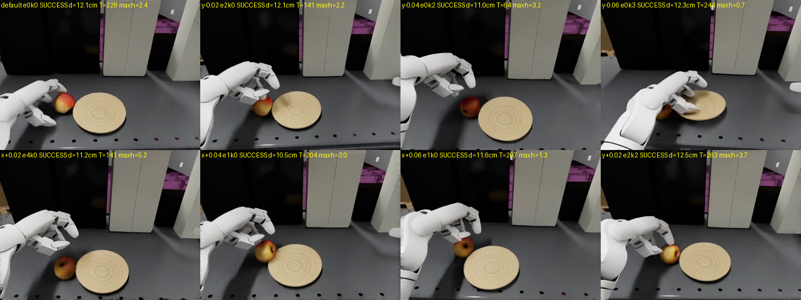

# Robot policy benchmarks on the Unitree G1 in IsaacLab-Arena

Results and notes from my work benchmarking learned robot policies in simulation with
[Isaac Lab-Arena](https://github.com/isaac-sim/IsaacLab-Arena). The main task is a **Unitree G1 humanoid picking an
apple off a shelf and placing it on a plate** ("G1 static apple pick-and-place"), evaluated mainly with NVIDIA's
GR00T N1.7 vision-language-action model and, in progress, compared with the OpenWAM world-action model.

This branch holds only this summary and its figures. The code lives on the other branches of this repository
(see [Code](#code)); the Arena framework itself is NVIDIA's.

## Evaluation protocol

Every number below is a closed-loop success rate in Arena simulation. The protocol settled over the project:

- **≥ 30 episodes per condition**, usually 2 runs × 30 (5 parallel environments, seed 42). Several early claims made
  at n ≤ 10 were overturned, so nothing below is based on fewer than 30 episodes.
- **Apple-position sweep**: the apple is moved from its default spot (±2 to ±6 cm toward/away from the plate and the
  robot, plus two held-out positions outside the training range); plate and robot stay fixed.
- **Physics warm-up** (100 steps) before the first episode, which removes a large first-episode penalty (below).
- **On-plate success**: the built-in success check also fires when the apple rests against the plate's rim, so I
  report *scored success AND final apple–plate distance < 8 cm*.
- Logged robot/apple state trajectories for failure classification, and the failure videos are watched.

## Results

### 1. Reproducing the reference workflow

| Policy | Success (my evaluation) |
|---|---|
| NVIDIA's released G1 apple policy | **86.7%** (30 eps) |

All failures were timeouts clustered in each robot's **first episode** (40% success vs 96% afterwards). A longer
timeout and shorter action chunks were both tested and **refuted** as fixes (chunk 8 → 53%). A short physics
warm-up removed the effect (first attempts 7/25 → 20/20) and became part of the protocol.

### 2. Fine-tuning GR00T N1.7 on different demonstration sets

| Training data | Success (60 eps) |
|---|---|
| My 20 VR-teleoperated demos | **91.7%** |
| 20 of NVIDIA's public demos | 78.3% |
| All 208 public demos (same recipe) | 26.7% — likely too little training per demo; 43 demos were empty |

The evaluation is **not bit-repeatable** at a fixed seed (27/30 vs 28/30 on reruns), one more reason for ≥ 60 eps.

### 3. Robustness to the apple's position

- Moving the apple 4–6 cm toward the plate drops NVIDIA's released policy from ~88% to **3%**.
- Training on demos with the apple placed randomly (#4) helps toward the plate (72% vs 30% at 4 cm) but costs
  accuracy at the default spot.
- Logged trajectories plus a failure classifier show **62–69% of failures are the hand going to a remembered
  location** (the default spot, or where the apple was before it was pushed), not grasp-mechanics errors.
- Recovery demos (push, then re-grasp) gave 72% across 7 shifted positions, but a replicate built from a different
  10 demos gave only 50%: *which* demos are chosen mattered as much as *what kind*.

### 4. Generated demonstrations (Isaac Lab Mimic): coverage beats quantity

200 demos each were generated from a few seed demos with a narrow (±2 cm) or wide (±5 cm) apple spread
(10 positions × 60 eps):

| Model | 7 shifted positions | Reach follows the apple (slope, 1 = perfect) |
|---|---|---|
| **Mimic wide (±5 cm)** | **78%** | 0.72 / 0.81 (x / y) |
| Mimic narrow (±2 cm) | 67% | 0.44 / 0.30 |
| 20 VR demos (#4) | 65% | 0.46 / 0.07 |

With the warm-up and the stricter on-plate metric, the wide-Mimic model is the current baseline:
**80% on-plate across the 7 shifted positions**, 48% at a held-out position 8 cm toward the plate.

*Episodes the built-in check scored as successes although the apple ended against the plate's rim (d = 11–12 cm
from the plate centre). Correcting for this lowered the held-out result from 82% to 45%.*

### 5. OpenWAM vs GR00T on the same 200 demos — in progress

Same data, same camera and joint inputs/outputs, same evaluation; only the model changes.

| | Status / result |
|---|---|
| Integration | OpenWAM policy server + Arena client (`mykechen/feature/openwam-policy`); multi-env plumbing tested in sim |
| Training setup | action expert only (2.6 B params; 5.1 B pretrained video backbone frozen) — full fine-tuning (7.7 B) does not fit on 2 × 48 GB GPUs; 3,000 steps (~44 h) |
| Inference speed | **4.0–4.3 s per plan** in bf16 on one A6000 (one plan = 0.64 s of robot motion) |
| Success rates | pending (10-position sweep after training) |

Notable integration findings: the released pretrained weights use different parameter names than the action model,
and the loader silently skipped 96% of them with only a warning; the default config ran the video encoder on the
CPU at inference, which made a single plan take minutes.

## Lessons

- No conclusions below ~30 episodes; three claims were overturned at n ≤ 10.
- Verify a suspected cause in the data before acting on it; change one variable at a time.
- Check what a metric actually measures (the rim false positive), and watch the videos.
- "It runs" is not "it's right": read the load reports and warnings of every training start.

## Code

| Branch | What it adds |
|---|---|
| `mykechen/feature/g1-static-apple-robustness` | apple/plate offset options, logged sweeps, state-trajectory logging |
| `mykechen/feature/g1-static-apple-mimic` | Isaac Lab Mimic config and tooling for the G1 apple task |
| `mykechen/feature/g1-static-apple-recovery` | recovery-demo (push + re-grasp) generation |
| `mykechen/feature/openwam-policy` | OpenWAM remote-policy client for the G1 |
| `mykechen/wip/forced-failure-eval` | work in progress, untested |
| `mykechen/archive/droid-mug-experiments-2026-09` | earlier Franka/DROID mug benchmark (reference) |

Built on Isaac Lab-Arena (Apache-2.0) by NVIDIA; GR00T N1.7 by NVIDIA; OpenWAM by its authors (AGPL-3.0, kept in a
separate repository).
